> **项目仓库地址：**
>
> https://github.com/Ding-1203/NKU-advanced-computer-systems-HW1-fio

## 一、测试环境

本实验在本人个人电脑上完成，具体环境如下：

- **CPU**：AMD Ryzen 7 8845H @ 3.80 GHz（8 核 16 线程）
- **内存**：24 GB
- **存储设备**：NVMe SSD（固态硬盘）
- **操作系统**：本机原生系统是 Windows 11
- **运行环境**：WSL（Windows Subsystem for Linux）


## 二、基础性能测试

首先，我先在项目目录里按要求创建了一个5GB大小的测试文件作为测试读写空间：

```
fallocate -l 5G fio_test_file
```

> 基准性能测试参数为：块大小 bs=4k, I/O引擎为pvsync, 线程数 numjobs=1,  I/O 深度 iodepth=1

按照这个要求，我设计了基础测试脚本basic_test.fio

```
[seq_read]
filename=/home/ding/advanced-computer-systems/hw1-fio/fio_test_file
rw=read
bs=4k
numjobs=1
iodepth=1
ioengine=psync
size=1G
runtime=20
time_based
stonewall=1
(只节选了顺序读的片段，后面其他三种同理)
```

规定了测试时间是20秒（time_based），在测试过程中持续对文件前 1GB 区域进行操作。同时用stonewall参数来实现在同一个脚本里一键串行多个任务进程，完成完整实验（不然要写一大堆脚本，或者不加这个参数就会并行进行，产生相互干扰）

以下是测试结果：

| 测试类型            | IOPS  | 带宽 BW    | 平均延迟 |
| ------------------- | ----- | ---------- | -------- |
| 顺序读 (seq read)   | 149k  | 581 MiB/s  | 5.8 μs   |
| 顺序写 (seq write)  | 184k  | 718 MiB/s  | 4.3 μs   |
| 随机读 (rand read)  | 17.1k | 66.6 MiB/s | 57 μs    |
| 随机写 (rand write) | 173k  | 676 MiB/s  | 4.2 μs   |

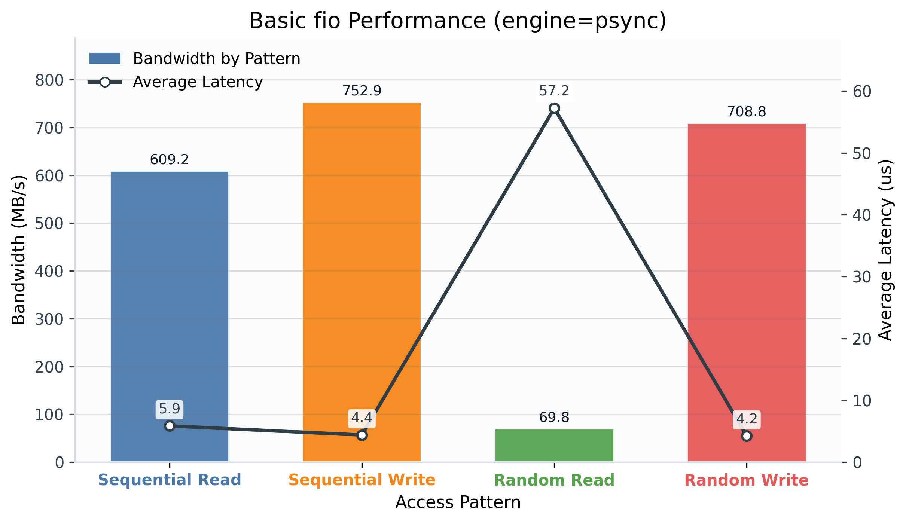

首先，有一个基础知识就是：$Bandwidth (BW)=IOPS×Block Size (bs)$

**在固定块大小时，考察带宽BW和考察每秒操作数IOPS是同理的**，因此后面对于此类情况，我都直接对更直观的指标“带宽BW”进行分析了，而这个指标也是直接代表了”性能“的关键指标。

观察基础测试的结果，我们可以发现这样几个现象：

### 现象 1：随机读的性能远低于顺序读

观察到顺序读的性能是随机读的将近十倍，而延迟则接近1/10. 

这个很容易理解，因为顺序读访问的是连续数据块，能够将连续信息装到cache里，利用数据的空间局部性；顺序读时，因为读取的地址是连续的，操作系统还可以借助预取机制提前加载数据。而随机读时，地址离散，无法预读，也无法利用内存的空间局部性，每次 I/O 都是独立请求，因此每次寻址取读都要花费较长时间，延迟大幅提高、IOPS和带宽大幅下降。

### 现象 2：随机写和顺序写的性能相近

读操作差距有十倍之多，但是到了写操作，随机和顺序的性能差距反而不到10%.

这是很反直觉的结论，但是查找资料后也了解了其中的原因。首先，SSD 不像 HDD，没有机械寻道，因此在这一步的成本就省去了（但是读操作也是如此，但是读操作依然有差距，因此这不是本质原因）。更关键的原因是，在我的操作系统中，写操作写入到page cache后，后面真正的写盘操作是异步实现的，程序可以直接返回；同时，SSD 还带有 FTL（Flash Translation Layer），会对写请求进行地址映射，并结合写缓冲、垃圾回收等机制，将离散的随机写尽可能组织成更适合闪存介质的写入方式，因此从外部观察时，随机写性能常常会接近顺序写。

相比之下，读操作必须按请求地址立即返回数据，如果缓存未命中就有延迟惩罚，无法通过“后台写+缓存重排”来隐藏随机访问的开销，因此随机读和顺序读的性能差距会直接暴露出来。

### 现象 3：写性能整体高于读性能，随机访问时更明显

这个原因刚刚其实已经说过了，本质就是写请求可以写入缓存就返回，然后后台异步写入，但是读请求必须真正获取到数据，如果缓存未命中就要等延迟。

> 通过基础性能测试，我了解了，在当前实验环境中，**写操作**由于受到操作系统 page cache 以及 SSD 内部机制（如 FTL、写缓冲等）的影响，**其随机性被较大程度地“隐藏”**，不同访问模式之间的差异不明显。相比之下，**读操作**无法通过缓存和重排来掩盖访问模式带来的影响，其性能差异**能够更加直接地反映底层存储系统的特性**。因此，在后续进阶对比实验中，我选择了 **顺序读 和 随机读** 作为**主要研究对象**，以更清晰地观察不同参数对 I/O 性能的影响。


## 三、块大小对读写性能的影响

我在基础参数设定的基础上，只调整了块大小这一参数，参数取值涵盖 4K, 16K, 64K, 256K, 1M

<figure>
    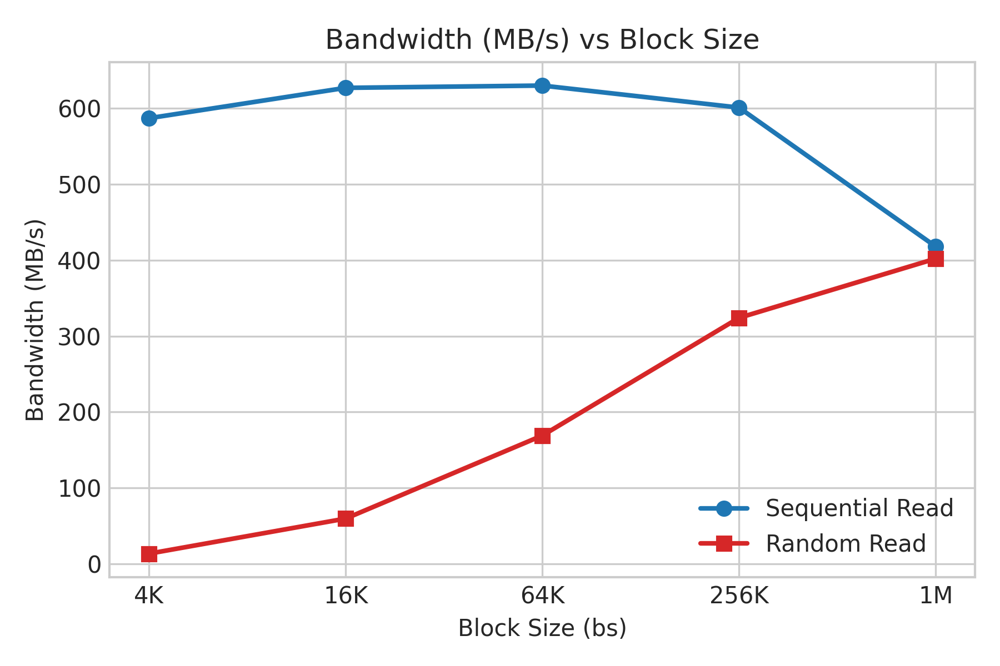
    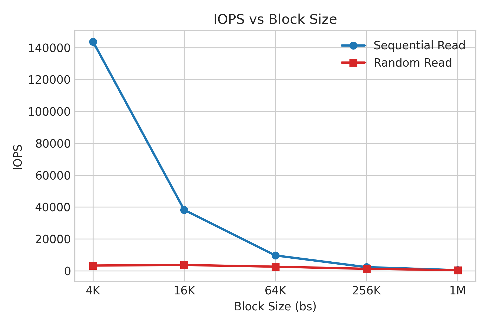
    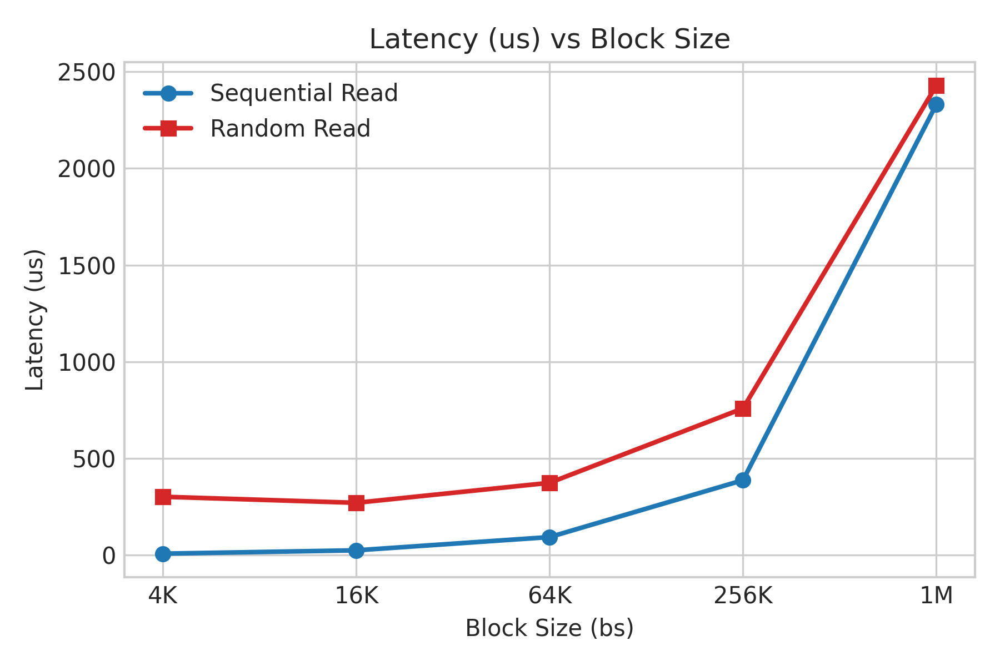
</figure>

从实验结果看，**顺序读带宽随块大小增大呈现“先升后降”的趋势，而随机读带宽则持续上升**（图1）。其原因在于，带宽本质上由块大小和 IOPS 共同决定：
$$
Bandwidth (BW)=IOPS×Block Size (bs)
$$

增大块大小，单次请求的延迟便会增大（因为单次要传输的数据量就增大了），相应地，请求数IOPS便会减少，因此整体带宽性能，本质上是块大小与IOPS（或者块大小与延迟）的权衡。

对于顺序读，它本身就很高效，数据是连续的、操作系统能预读、SSD 也能连续处理，块大小较小时请求延迟非常低（图3）、IOPS 很高（图2），这时候，适当地增大块大小，单次传更多数据”带来的收益 \> “请求次数减少”带来的损失。但是后面块大小进一步增大，延迟陡增、IOPS陡降，超过了系统最合适的请求粒度，性能便转而下降了。

相比之下，随机读在块大小较小时IOPS就非常低，每次随机访问都需要付出很高的固定开销（如地址跳转、控制器处理以及较低的缓存命中率），这些固定开销是顺序读所没有的；因此块大小的提升对它来说性价比更高，虽然延迟也会相对增大、IOPS 也会相对下降，但是单次传输量的增长确是实打实的，bs 增大的收益始终大于 IOPS 下降的损失。

可以说，顺序读在小块时已经接近高效状态，后续提升空间有限，因此很快受到延迟和 IOPS 下降的限制；而随机读在小块时效率较低，存在较大的优化空间，增大块大小能够显著提升单次请求的有效数据量，从而持续提高带宽表现。


## 四、并发与队列深度 (numjobs & iodepth) 的影响

在本部分实验中，我在固定块大小的情况下，调整并发线程数（numjobs）和队列深度（iodepth），以分析并发程度对 I/O 性能的影响。这里，我设置numjobs的取值涵盖 1、2、4、8，iodepth的取值涵盖 1、4、16、64；测定BW（多jobs累加得到）和延迟（多jobs取平均得到）。

> `iodepth` 表示单个 job 同时挂在设备上的未完成 I/O 请求数量上限，也就是每个 job 一次最多能“排队”多少个请求。当前请求进入等待（控制器调度、闪存访问、数据返回等）时，可以切换另一个请求，来抹平等待阻塞的时间，是“内层并发数”。
>
> `numjobs` 表示 fio 同时并发启动多少个 job，可以理解为有多少个线程 / 进程同时在做 I/O，是“外层并发数”。在多核 CPU（如本实验的 8 核 16 线程）下，不同 job 可以运行在不同的核上，从执行层面看确实形成了并行。然而在 I/O 场景中，性能瓶颈通常不在 CPU 计算能力，而在存储设备 SSD 的访问延迟。因此，numjobs 提升性能的本质并不在于 CPU 多核并行，而在于 SSD 的并行资源（多 channel / die），以及同样在于增加并发请求数量来抹平等待（只不过不是单流多请求，而是多条请求流）：当某个 job 因等待 I/O 完成而阻塞时，其他 job 仍可以继续提交请求。

### 先来看 numjobs 对性能的影响：

<figure>
    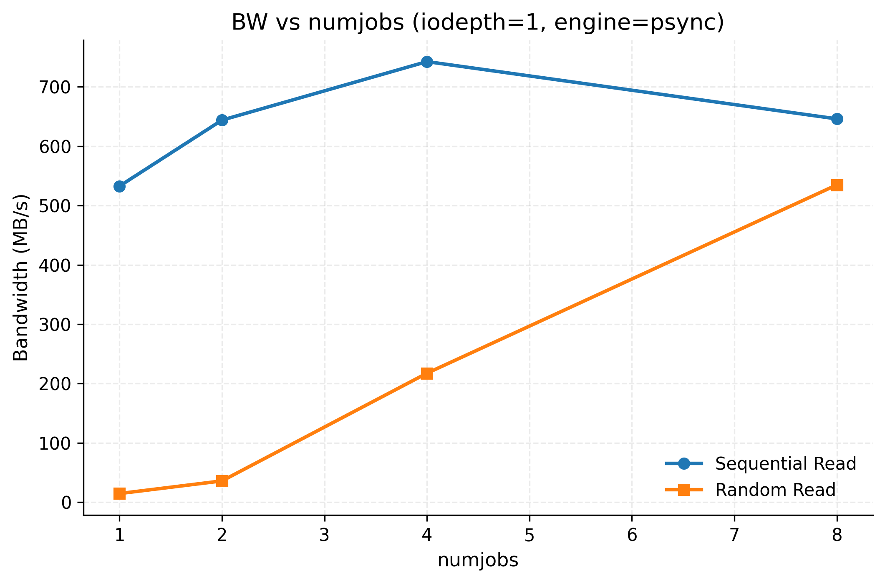
    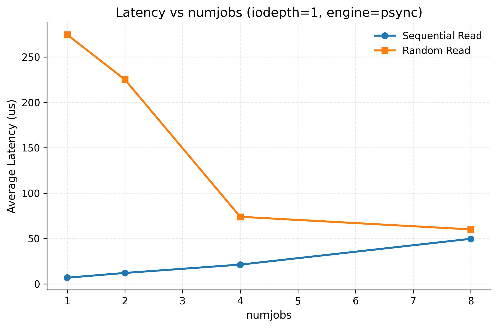
</figure>

当 iodepth 固定时：

- 顺序读的带宽 随 numjobs 增大，先上升后下降，在 numjob = 4 时达到峰值
- 随机读的带宽 随 numjobs 增大持续上升
- 顺序读的延迟 随 numjobs 增大略有上升
- 随机读的延迟 随 numjobs 增大显著下降，逐渐逼近顺序读的延迟

对于随机读，numjobs = 1 时单请求的延迟极高，SSD 内部并行资源基本闲置，读效率很低，随着 numjobs 增大，并行资源得以利用，等待时间也被摊薄，平均请求延迟大幅下降，单位时间内能完成更多的读请求，这自然就带来了更高的带宽。

对于顺序读，情况有所不同，顺序访问本身已经接近最优路径（预读 + 连续访问），初始延迟就很低，多个 job 反而会打乱访问连续性、增加调度成本和缓存争用，使平均延迟逐渐上升。在前期，还可以通过利用 SSD 的并行资源，并行多个请求来提升总带宽，当并行资源逐渐饱和后，请求延迟的增加反而让 numjobs 的进一步提高得不偿失。

---

### 并发与队列深度的联合影响：

接下来理应看固定 numjobs 时，提升 iodepth 的影响了，但是按照基础设定，使用 psync 这个同步阻塞式  I/O 引擎时，单个 job 实质上根本无法挂多个请求，因此对 iodepth 完全不敏感，没有实验效果；因此考虑使用异步引擎 io_uring 进行后续实验。

> 具体分析 “引擎带来的性能区别” 以及 “不同引擎在并发场景中的发挥” 的内容可见下一章节，这里只做简述来讲清实验设定。

下面是使用异步引擎 io_uring 对各种并发参数组合进行实验、根据测定的带宽和延迟分别作出的热力图。结合热力图现象分析，得到结论如下：

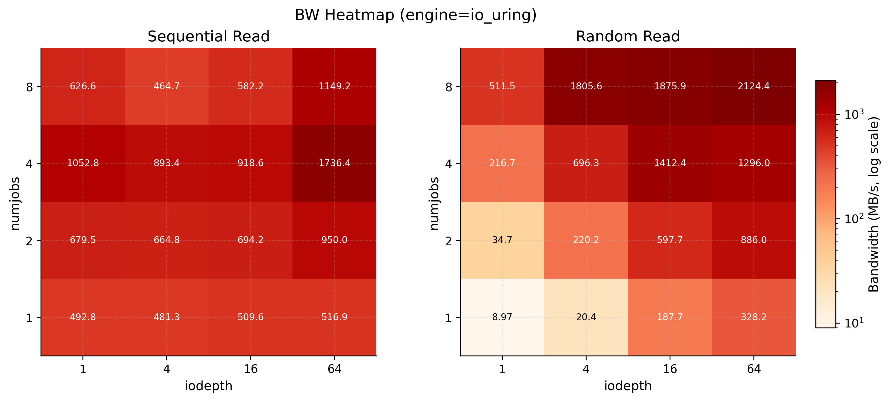

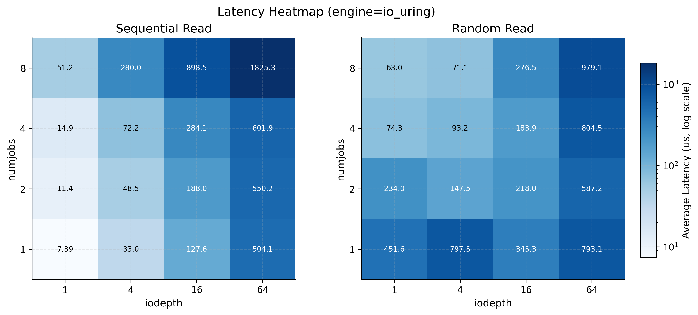

#### 结论 1：顺序读对并发不敏感

前面的实验已经提过，numjobs 的适度增大能略微提升顺序读的性能，但是继续增大时却会带来性能的回落，这个现象在热力图中也能看出。另外，在当前实验环境中，队列深度的提升对顺序读性能的影响很小，只有在特定高并发场景下，会出现性能的跳变提升，猜测可能是顺序读更不易触发并行资源的利用。在延迟层面，队列深度的提升自然会带来平均等待时间的延长，属于是经典的拿延迟换吞吐。整体来说，顺序读的基础性能已经比较不错，并发对其性能提升的作用比较有限，过度并发甚至会出现负作用。

#### 结论2：随机读强烈依赖并发

低并发时，随机访问单次开销大，单请求无法利用 SSD 内部并行结构，延迟高而带宽低；当并发程度提升后，无论是增加 numjobs 还是增大 iodepth，都能显著提高同时在途的请求数量。实验结果表明，随机读带宽随总并发度（可近似理解为 `numjobs × iodepth`）增大而呈现近似线性关系的上升，也就是说，随机读性能几乎完全由并发驱动。

其中，`iodepth` 的提升虽然会带来排队加深，从而推高单请求平均延迟，但它能够更充分地利用 SSD 的内部并行结构，因此整体收益仍然明显大于延迟增加带来的代价；而在较低队列深度下，增加 `numjobs` 则相当于增加多条独立请求流，可以有效覆盖单个请求的等待时间，在一定范围内甚至表现为平均延迟下降、聚合带宽上升。

#### 结论 3：并发提升中，吞吐与延迟的权衡关系

从整体实验结果可以看出，并发提升带来的性能变化，本质上体现为吞吐（带宽）与延迟之间的权衡关系。无论是增加 numjobs 还是增大 iodepth，都会提高系统中同时在途的请求数量，使 SSD 内部并行资源得到更充分利用，从而提升 IOPS 和带宽表现；但与此同时，请求在队列中的排队时间也会增加，导致单个请求的平均延迟上升。

这一现象在 iodepth 提升时尤为明显：随着队列深度增加，请求在设备端形成更深的排队，延迟呈现明显增长，但带宽也随之提升，体现出典型的“以延迟换吞吐”的特征。而在 numjobs 提升时，这种权衡则更加复杂：在低并发阶段，通过增加请求流可以有效覆盖等待时间，甚至在随机读场景下表现为延迟下降；但当并发进一步提高后，系统进入资源竞争与排队主导阶段，延迟同样会逐渐上升。

这一权衡关系也是实际系统设计中需要重点考虑的问题：不同应用场景（如在线服务 vs 批处理任务）对延迟和吞吐的敏感性不同，因此需要在并发参数上做出不同取舍。


## 五、I/O 引擎 (ioengine) 的对比

在基础参数设定的基础上，我切换了各种 I/O 引擎进行实验，包括 psync, libaio, io_uring, mmap。在各种引擎条件下分别测定顺序读和随机读的 BW 和 latency，结果如下：

<figure>
    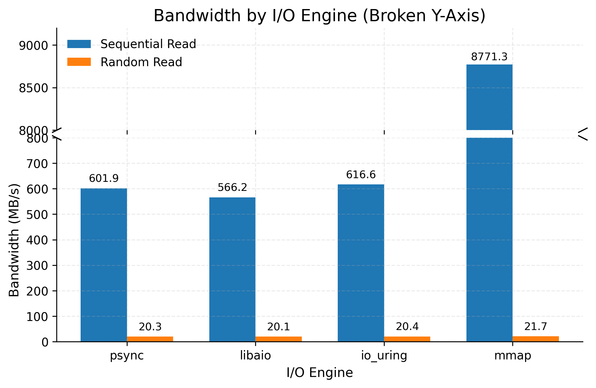
    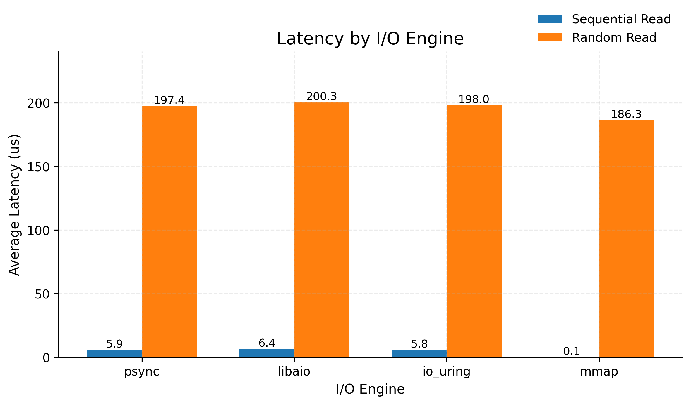
</figure>

### 整体分析

从整体结果来看，psync、libaio 和 io_uring 三种引擎在本实验配置下（numjobs=1, iodepth=1）表现非常接近。无论是在顺序读还是随机读场景中，它们的带宽基本处于同一数量级，延迟也差异不大。这一现象的原因在于，尽管 libaio 和 io_uring 属于异步 I/O 模型，但在当前设置中每次仅允许一个未完成请求（iodepth=1），因此无法形成真正的请求并发，其执行方式在效果上退化为同步 I/O。也就是说，在低并发场景下，I/O 引擎的差异并不会显著体现出来，性能主要仍由底层存储设备决定。

相比之下，mmap 的表现则呈现出明显的“离群”特征。在顺序读场景下，其带宽达到了约 8700 MB/s，远高于其他引擎的约 600 MB/s，同时平均延迟也下降到了约 0.1 μs，明显低于常规 I/O 的微秒级水平。这一结果已经超出了 SSD 的物理性能上限，接近甚至达到了内存带宽水平。

产生这一现象的根本原因在于 mmap 并不遵循传统的 I/O 访问路径。传统 I/O（如 psync、io_uring）需要通过系统调用进入内核，由内核从 page cache 或磁盘中读取数据，再拷贝到用户空间；而 mmap 则是将文件直接映射到进程的虚拟地址空间中，应用程序通过内存访问即可读取数据。当数据已经存在于 page cache 中时，访问实际上变成了对内存的直接访问，从而避免了系统调用和数据拷贝的开销。

但是一旦把视角切换到随机读场景，我们就发现 mmap 的优势荡然无存了，因为每次访问基本都要触发 page fault，因而还是需要从磁盘加载，这个路径优化就无效了。本质上，mmap 并不是一种“更高效的 I/O 引擎”，它只是改变了数据访问路径的机制，绕过传统 I/O 路径，将文件访问转化为内存访问，从而才获得了极高的带宽和极低的延迟，其在顺序读场景下测得的数据其实并不能真实反映磁盘 I/O 性能。

### 并发场景分析

在之前的实验中，我们发现并发场景下，不同 I/O 引擎的表现有所不同，这里进行具体分析。将之前的并发实验在 psync、libaio 和 io_uring 三种引擎上分别都重复一遍，将其热力图进行横向对比分析：

<figure>
    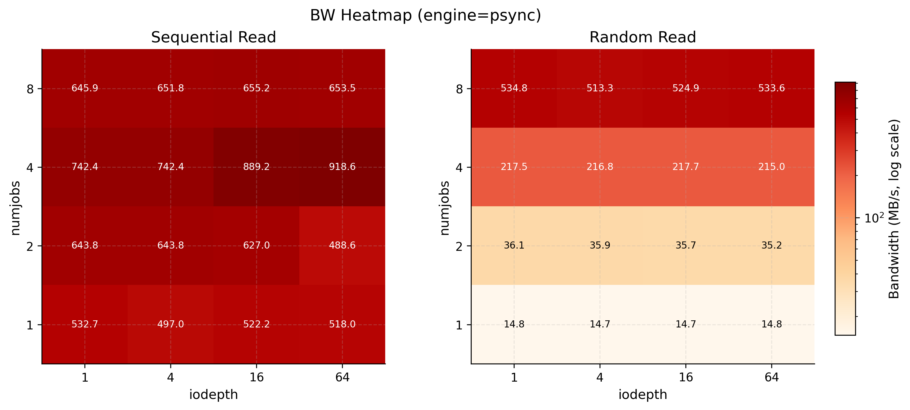
    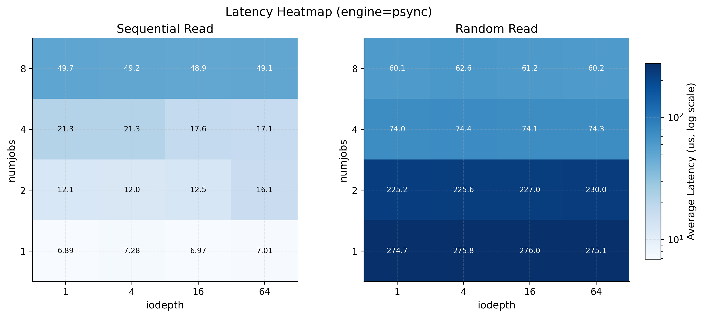
</figure>

<figure>
    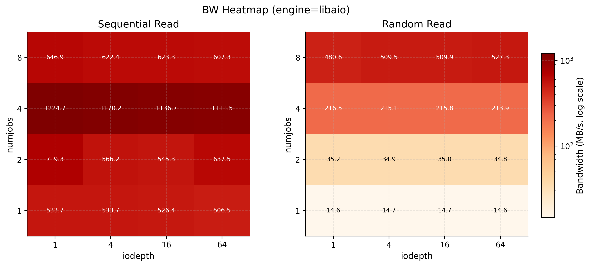
    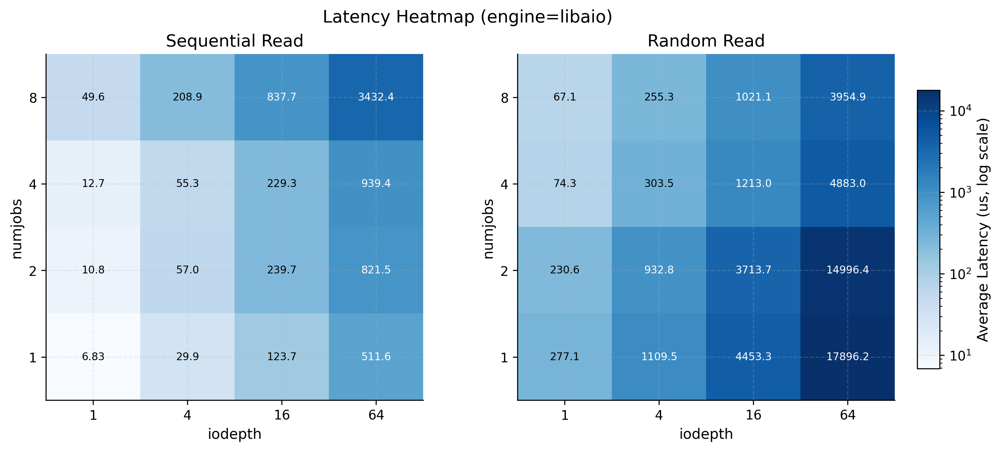
</figure>

<figure>
    
    
</figure>

从上到下三行分别对应了 psync、libaio 和 io_uring 三种引擎下的实验结果图。

首先可以观察到，在 psync 引擎下，无论是顺序读还是随机读，带宽基本不随 iodepth 的变化而变化，只随 numjobs 增加而提升。这是因为 psync 是同步阻塞式 I/O，引擎本身不支持单个 job 挂起多个未完成请求，即使设置了更大的 iodepth，实际执行过程中也只能串行提交请求，因此 iodepth 实质是无效的。在这种情况下，系统的并发度完全由 `numjobs` 决定，本质上是“多线程并发多个单请求流”，而不是“单线程多请求队列”。

在 libaio 引擎下，可以观察到情况发生了变化。作为一种异步 I/O 引擎，libaio 在接口层面支持并发请求的提交，因此 iodepth 的变化不再像 psync 那样完全无效。从实验结果来看，随着 iodepth 的增加，平均延迟明显上升，这表明系统中确实积累了更多未完成的 I/O 请求，即请求队列在不断加深，单个请求从发出到完成所经历的等待时间也随之增加。然而，与延迟的变化不同，带宽并未随队列深度增加而提升，仍主要由 numjobs 决定。这表明这些额外请求虽然被提交，但未能在设备层面实现有效并行，而是更多停留在排队阶段。从本质上看，这并非 libaio 本身的局限，而是由于实验运行在 WSL 环境中，I/O 请求需要经过虚拟化层转发，未能直接作用于底层 NVMe 设备队列。因此，iodepth 的增加仅表现为排队加深（延迟上升），而未能转化为吞吐提升。

在 io_uring 引擎下，可以明显观察到其终于真正实现了性能层面的异步并发执行。随着 iodepth 的增加，带宽不再像前两种引擎那样基本不变，而是出现明显提升，尤其在随机读场景中更加显著。同时，延迟也随队列深度增加而上升，体现出典型的排队效应。这说明 io_uring 能够将更深的请求队列有效传递到内核及设备层，从而转化为实际并行执行，充分利用 SSD 的内部并行能力。

横向对比可以看出，在当前实验环境下，`io_uring` 在高并发场景中能够更有效地将并发请求转化为实际吞吐，表现出更合理的带宽提升与延迟增长关系，同时也具备更高的性能上限，因此更适合用于高并发 I/O 场景。总体来说，而在低并发条件下，各类引擎的性能差异较小，主要受存储设备本身限制；随着并发程度提升，引擎在请求提交、调度与执行路径上的设计差异被逐步放大，从而对整体性能产生显著影响。


> ### **附录：AI 使用情况**
>
> **本次作业中，在基础知识预备、查找资料，以及可视化相关脚本的编写中借助了AI工具**


